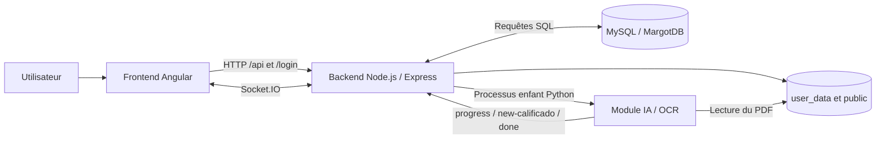

# Madrina

Madrina est une application web destinée aux enseignants pour importer, découper,
identifier, noter et redistribuer des copies d'examen numérisées.

L'application permet notamment de :

- gérer des utilisateurs, des matières, des étudiants et des examens ;
- importer un PDF contenant plusieurs copies ;
- convertir le PDF en images pour une vérification manuelle ;
- détecter automatiquement le début de chaque copie ;
- reconnaître le DNI/NIF manuscrit et la note avec deux modèles CNN ;
- associer chaque copie à un étudiant ;
- corriger ou valider les résultats ;
- générer un ZIP contenant les copies individuelles et les fichiers CSV de notes.

## Sommaire

- [Architecture](#architecture)
- [Structure du dépôt](#structure-du-dépôt)
- [Technologies](#technologies)
- [Prérequis](#prérequis)
- [Installation locale](#installation-locale)
- [Configuration](#configuration)
- [Lancement](#lancement)
- [Fonctionnement des modules](#fonctionnement-des-modules)
- [Base de données](#base-de-données)
- [API et WebSocket](#api-et-websocket)
- [Tests et vérifications](#tests-et-vérifications)
- [Déploiement en production](#déploiement-en-production)
- [Données persistantes et sauvegardes](#données-persistantes-et-sauvegardes)
- [Limitations et points de vigilance](#limitations-et-points-de-vigilance)
- [Dépannage](#dépannage)

## Architecture

Le projet est composé de trois modules applicatifs et d'une base MySQL.



Le module IA n'est pas un serveur HTTP indépendant. Le backend lance
`AsistenteWebTFGBackendAIModule/main.py` comme processus enfant lors de
l'événement Socket.IO `examen-predict`.

## Structure du dépôt

```text
Madrina/
├── AsistenteWebTFG/                   # Frontend Angular
│   ├── src/app/                       # Pages et composants
│   ├── src/services/                  # API, authentification, stockage, socket
│   ├── src/models/                    # Modèles TypeScript
│   └── src/environments/              # URLs backend dev/prod
│
├── AsistenteWebTFGBackend/            # Backend Express et Socket.IO
│   ├── bin/www                        # Point d'entrée du serveur
│   ├── routes/api.js                  # API métier authentifiée
│   ├── routes/login.js                # Inscription et authentification
│   ├── routes/socket.js               # Import PDF, images, ZIP et lancement IA
│   ├── DAL.js                         # Accès aux données utilisés par l'IA
│   ├── connection.js                  # Connexion MySQL
│   ├── user_data/                     # PDF et images de travail persistants
│   ├── public/                        # ZIP générés et téléchargeables
│   └── mail/                          # Modèle de récupération de mot de passe
│
├── AsistenteWebTFGBackendAIModule/    # Pipeline Python de reconnaissance
│   ├── main.py                        # Point d'entrée appelé par Node.js
│   ├── core/checkpoints/              # Modèles PyTorch utilisés en production
│   ├── Modules/                       # Émission des résultats, entraînement, test
│   ├── utils/                         # OCR, traitement PDF et modèles CNN
│   └── data/                          # Préparation et analyse des datasets
│
├── MargotDB.sql                       # Création du schéma MySQL
├── run_full_app.sh                    # Démarrage backend + frontend
├── lounch.sh                          # Lanceur du script précédent
└── README_projet.md                   # Documentation globale
```

Le dossier `OriginalVersion/` contient des versions historiques et ne participe
pas au fonctionnement courant de l'application.

## Technologies

### Frontend

- Angular 13 ;
- TypeScript 4.5 ;
- Angular Material et Angular CDK ;
- RxJS ;
- `ngx-socket-io` ;
- SCSS.

### Backend

- Node.js et Express 4 ;
- Socket.IO 4 ;
- MySQL avec `mysql2` ;
- génération d'archives avec `archiver` ;
- traitement de PDF avec Poppler et Ghostscript ;
- vues Pug pour les pages d'erreur.

### Module IA

- Python 3 ;
- PyTorch et Torchvision ;
- OpenCV ;
- NumPy et Pillow ;
- PyPDF2 ;
- Levenshtein ;
- deux modèles CNN :
  - `best_model.pt` pour les caractères du DNI/NIF ;
  - `exammodel4.pt` pour les chiffres de la note.

### Base de données

- MySQL ;
- schéma `MargotDB` ;
- tables principales : `usuarios`, `preferencias`, `asignaturas`, `alumnos`,
  `examenes`, `calificados` et `correo_validacion`.

## Prérequis

L'environnement cible recommandé est Debian ou Ubuntu.

- Node.js compatible avec Angular 13, de préférence Node.js 16 ;
- npm ;
- Python 3 et le module `venv` ;
- MySQL Server ;
- Poppler : `pdftoppm`, `pdfseparate` et `pdfunite` ;
- Ghostscript : `ps2pdf` ;
- la commande `mail` et un MTA configuré si la récupération de mot de passe est utilisée ;
- suffisamment d'espace disque pour les PDF, images JPEG temporaires et ZIP.

Installation des paquets système disponibles sous Debian/Ubuntu :

```bash
sudo apt update
sudo apt install mysql-server python3 python3-venv python3-pip \
  poppler-utils ghostscript mailutils
```

```bash
pdftoppm -v
pdfseparate -v
pdfunite -v
ps2pdf -h
```

Le GPU CUDA est facultatif. Le module IA choisit automatiquement CUDA lorsqu'il
est disponible et utilisable, sinon il fonctionne sur CPU.

## Installation locale

Toutes les commandes suivantes sont exécutées depuis la racine du dépôt.

### 1. Installer le frontend

```bash
cd AsistenteWebTFG
npm ci
cd ..
```

### 2. Installer le backend

```bash
cd AsistenteWebTFGBackend
npm ci
cd ..
```

### 3. Installer le module IA

Par défaut, le backend cherche `../.venv/bin/python`. Ce chemin est configurable
avec `AI_PYTHON_BIN`. L'environnement virtuel peut être créé à la racine :

```bash
python3 -m venv .venv
source .venv/bin/activate
python -m pip install --upgrade pip
python -m pip install \
  torch torchvision numpy Pillow opencv-python PyPDF2 \
  python-Levenshtein matplotlib pandas
deactivate
```

Les dépendances `torchvision`, `matplotlib` et `pandas` sont surtout utilisées
par les outils d'entraînement, de test et d'analyse des datasets.

Vérifier la présence des modèles :

```bash
test -f AsistenteWebTFGBackendAIModule/core/checkpoints/best_model.pt
test -f AsistenteWebTFGBackendAIModule/core/checkpoints/exammodel4.pt
```

### 4. Initialiser MySQL

Attention : `MargotDB.sql` supprime et recrée les tables du schéma. Ne pas
l'exécuter sur une base de production contenant des données sans sauvegarde.

```bash
mysql -u root -p < MargotDB.sql
```

Créer de préférence un utilisateur dédié :

```sql
CREATE USER 'madrina'@'localhost' IDENTIFIED BY 'mot_de_passe_solide';
GRANT SELECT, INSERT, UPDATE, DELETE
ON MargotDB.* TO 'madrina'@'localhost';
FLUSH PRIVILEGES;
```

## Configuration

### Backend

Créer `AsistenteWebTFGBackend/.env` :

```dotenv
DB_HOST=127.0.0.1
DB_USER=madrina
DB_PORT=3306
DB_PASSWORD=mot_de_passe_solide
DB_NAME=MargotDB
PORT=3000
AI_PYTHON_BIN=../.venv/bin/python
AI_MODULE_PATH=../AsistenteWebTFGBackendAIModule/main.py
AI_MODULE_USER_DATA_ROOT=./user_data
AI_PDF_WORKERS=4
AI_DETECTION_WORKERS=4
```

`connection.js` utilise `DB_HOST`, `DB_USER`, `DB_PASSWORD`, `DB_PORT`,
`DB_NAME` et `DB_CONNECTION_LIMIT`. Les valeurs Docker sont définies dans
`docker-compose.yml`.

Le serveur écoute sur le port `3000` par défaut. La variable `PORT` permet de le
modifier.

### Frontend

Développement :

```typescript
// AsistenteWebTFG/src/environments/environment.ts
backend: 'http://localhost:3000'
```

Production :

```typescript
// AsistenteWebTFG/src/environments/environment.prod.ts
backend: 'https://madrina.example.org'
```

La même URL est utilisée pour :

- les appels HTTP vers `/api` et `/login` ;
- la connexion Socket.IO ;
- les téléchargements exposés par le backend.

Le fichier `src/proxy.conf.json` contient une ancienne adresse distante et
n'est pas référencé par le script `npm start`. Pour un développement local
standard, la valeur utile reste `http://localhost:3000`.

### Courriels

Le fichier `AsistenteWebTFGBackend/mail/config.json` contient :

- le domaine utilisé dans les liens de réinitialisation ;
- l'objet du courriel.

Le backend appelle directement la commande système `mail`. La récupération de
mot de passe nécessite donc un MTA configuré et autorisé à envoyer les messages.

### Répertoires de travail

Le backend crée si nécessaire :

- `AsistenteWebTFGBackend/user_data/` pour les PDF et images d'examens ;
- `AsistenteWebTFGBackend/public/` pour les ZIP téléchargeables.

Le module IA crée temporairement :

```text
AsistenteWebTFGBackendAIModule/utils/.img-dumps/<index>/
```

Le processus système doit avoir les droits de lecture et d'écriture sur ces
répertoires.

## Lancement

### Lancement complet

Après installation et configuration :

```bash
chmod +x lounch.sh run_full_app.sh
./lounch.sh
```

Le script :

1. démarre le backend sur `http://localhost:3000` ;
2. attend deux secondes ;
3. démarre Angular sur `http://localhost:4200` ;
4. arrête le backend lorsque le frontend est interrompu.

Le script ne démarre pas MySQL et n'installe aucune dépendance.

### Lancement séparé

Terminal 1 :

```bash
cd AsistenteWebTFGBackend
npm start
```

Terminal 2 :

```bash
cd AsistenteWebTFG
npm start
```

Ouvrir ensuite :

```text
http://localhost:4200
```

### Exécution manuelle du module IA

Le lancement normal passe par le backend. Pour un diagnostic manuel :

```bash
cd AsistenteWebTFGBackendAIModule

AI_MODULE_USER_DATA_ROOT=/chemin/absolu/vers/AsistenteWebTFGBackend/user_data \
../.venv/bin/python main.py \
  "utilisateur-matiere-examen" \
  "nom_du_pdf_sans_extension" \
  '[{"dni":"12345678Z","nombre":"Ada","apellidos":"Lovelace"}]'
```

Le PDF attendu est :

```text
AsistenteWebTFGBackend/user_data/
└── utilisateur-matiere-examen/
    └── nom_du_pdf_sans_extension.pdf
```

## Fonctionnement des modules

### Frontend Angular

Les routes principales sont :

| Route | Fonction |
| --- | --- |
| `/#/login` | Authentification |
| `/#/sign-up` | Création de compte |
| `/#/password` | Réinitialisation du mot de passe |
| `/#/asignaturas` | Gestion des matières et examens |
| `/#/examen/:id` | Correction classique |
| `/#/examen-advanced/:id` | Correction automatisée avec l'IA |

Le frontend communique avec le backend à travers :

- `src/services/api/api.service.ts` pour l'API métier ;
- `src/services/authentication/authentication.service.ts` pour les comptes ;
- `src/services/socket/socket.service.ts` pour les fichiers et la progression.

### Backend Node.js

Le point d'entrée est `AsistenteWebTFGBackend/bin/www`.

Au démarrage, le backend :

1. charge Express ;
2. vérifie la connexion MySQL ;
3. crée les dossiers `public` et `user_data` si nécessaire ;
4. monte les routes `/api`, `/login`, `/info` et `/public` ;
5. initialise Socket.IO ;
6. écoute sur `PORT` ou sur `3000`.

Les routes `/api` sont protégées par un intercepteur qui vérifie l'identifiant
et le jeton de session dans la table `usuarios`.

### Pipeline IA

Lorsqu'un client émet `examen-predict`, le backend :

1. construit l'index `<utilisateur>-<matiere>-<examen>` ;
2. charge la liste des étudiants de la matière ;
3. lance `main.py` avec Python ;
4. transmet `AI_MODULE_USER_DATA_ROOT` au processus ;
5. lit les résultats ligne par ligne ;
6. insère les copies reconnues dans `calificados` ;
7. marque l'examen comme prédit.

Le pipeline Python :

1. charge les deux checkpoints PyTorch ;
2. convertit les zones utiles du PDF en images avec `pdftoppm` ;
3. détecte les premières pages des copies ;
4. extrait et reconnaît les caractères du DNI/NIF ;
5. associe le résultat OCR à l'étudiant le plus proche ;
6. reconnaît la note manuscrite ;
7. émet le résultat et supprime les images temporaires.

Protocole de sortie standard :

```text
progress <pourcentage> <état>
new-calificado <json_etudiant>
done <durée>
```

La documentation détaillée du module est disponible dans
`AsistenteWebTFGBackendAIModule/README_AI_ASSISTANCE.md`.

## Base de données

Relations principales :

```text
usuarios
├── preferencias
└── asignaturas
    ├── alumnos
    └── examenes
        └── calificados

usuarios
└── correo_validacion
```

Description des tables :

| Table | Rôle |
| --- | --- |
| `usuarios` | Comptes, mot de passe chiffré et jeton de session |
| `preferencias` | Encodage, séparateur CSV et présence d'une ligne d'en-tête |
| `asignaturas` | Matières appartenant à un utilisateur |
| `alumnos` | Étudiants inscrits dans une matière |
| `examenes` | Métadonnées et état de traitement des examens |
| `calificados` | Étudiant, pages, note et état de vérification |
| `correo_validacion` | Jetons de récupération de mot de passe |

Sauvegarde :

```bash
mysqldump -u madrina -p --single-transaction MargotDB > MargotDB-backup.sql
```

Restauration :

```bash
mysql -u madrina -p MargotDB < MargotDB-backup.sql
```

## API et WebSocket

### API HTTP

Les routes utilisent principalement `POST`.

Routes publiques de compte :

```text
POST /login/insert
POST /login/select
POST /login/delete
POST /login/correo/insert
POST /login/correo/select
POST /login/password/update
```

Principales routes authentifiées :

```text
POST /api/asignaturas
POST /api/asignaturas/insert
POST /api/asignaturas/update
POST /api/asignaturas/delete
POST /api/asignaturas/select/alumnos

POST /api/examen/insert
POST /api/examen/select
POST /api/examen/delete
POST /api/examen/zip
POST /api/examen/alumnos/select
POST /api/examen/alumnos/select-automatizado

POST /api/calificado/insert
POST /api/calificado/update
POST /api/calificado/update-automatizado

POST /api/preferencias/select
POST /api/prediction/statistics
POST /api/usuario/update/correo
```

### Événements Socket.IO

Événements principaux envoyés par le client :

```text
insert-alumno
insert-examen
select-examen-imgs
select-examen-zip
examen-predict
examen-predict-kill
```

Événements principaux émis par le serveur :

```text
insert-examen-procesar
insert-examen-crear
insert-examen-generar
insert-examen-preparar
insert-examen-listo
insert-examen-error
select-examen-imgs
select-examen-zip
examen-predict-response
```

## Tests et vérifications

### Frontend

```bash
cd AsistenteWebTFG
npm test
npm run build
```

Les tests unitaires Angular utilisent Karma et nécessitent un navigateur Chrome
ou Chromium compatible.

### Backend

Le backend ne définit actuellement pas de suite de tests dans `package.json`.
Vérification minimale :

```bash
cd AsistenteWebTFGBackend
npm start
```

Le serveur doit confirmer son démarrage sans afficher d'erreur MySQL.

### Module IA

Vérification des imports de production :

```bash
source .venv/bin/activate
python -c "import torch, cv2, numpy, PIL, PyPDF2, Levenshtein"
deactivate
```

Les scripts `Modules/train/train.py`, `Modules/test/test.py` et `example.py`
sont actuellement couplés au chargement des arguments de `utils/constants.py`.
Leur interface autonome doit être découplée avant de pouvoir les intégrer à une
CI standard. Les scripts de préparation sous `data/` restent indépendants.

### Parcours de validation conseillé

1. créer un compte ;
2. créer une matière ;
3. importer la liste des étudiants ;
4. créer un examen ;
5. envoyer un PDF contenant plusieurs copies ;
6. vérifier la conversion des pages ;
7. lancer la prédiction ;
8. corriger les associations et les notes ;
9. générer et télécharger le ZIP ;
10. contrôler les PDF et CSV produits.

## Déploiement en production

Le déploiement recommandé utilise les Dockerfiles et `docker-compose.yml`
présents à la racine. La procédure complète est décrite dans
[`README_deploy.md`](README_deploy.md). Démarrage rapide :

```bash
docker compose up --build -d
docker compose logs -f
```

Le frontend est disponible sur `http://localhost:4200`. Nginx relaie les API,
Socket.IO, `/public/` et `/info/` vers le backend. Le module IA s'exécute dans
le conteneur backend, comme processus Python enfant, et non comme service HTTP.

La procédure suivante reste valable pour une installation sans Docker avec
Nginx et systemd.

### 1. Préparer le serveur

```bash
sudo apt update
sudo apt install nginx mysql-server python3-venv python3-pip \
  poppler-utils ghostscript mailutils
```

Installer également :

- Node.js 16 et npm ;
- un certificat TLS, par exemple avec Certbot ;
- un MTA fonctionnel si l'envoi de courriels est requis.

### 2. Installer l'application

Exemple de répertoire :

```text
/opt/madrina/
```

Installer les dépendances comme dans la section
[Installation locale](#installation-locale), créer `/opt/madrina/.venv`, puis
configurer :

```text
/opt/madrina/AsistenteWebTFGBackend/.env
```

Le compte système qui exécute le backend doit pouvoir écrire dans :

```text
/opt/madrina/AsistenteWebTFGBackend/user_data
/opt/madrina/AsistenteWebTFGBackend/public
/opt/madrina/AsistenteWebTFGBackendAIModule/utils/.img-dumps
```

### 3. Construire le frontend

Configurer d'abord `environment.prod.ts` avec le domaine public :

```typescript
backend: 'https://madrina.example.org'
```

Puis :

```bash
cd /opt/madrina/AsistenteWebTFG
npm ci
npm run build
```

Les fichiers statiques sont générés dans :

```text
/opt/madrina/AsistenteWebTFG/dist/frontend/
```

### 4. Créer le service systemd

Créer `/etc/systemd/system/madrina-backend.service` :

```ini
[Unit]
Description=Madrina Backend
After=network.target mysql.service
Requires=mysql.service

[Service]
Type=simple
User=madrina
Group=madrina
WorkingDirectory=/opt/madrina/AsistenteWebTFGBackend
Environment=NODE_ENV=production
ExecStart=/usr/bin/node ./bin/www
Restart=on-failure
RestartSec=5

[Install]
WantedBy=multi-user.target
```

Adapter le chemin de Node.js obtenu avec :

```bash
command -v node
```

Activer le service :

```bash
sudo systemctl daemon-reload
sudo systemctl enable --now madrina-backend
sudo systemctl status madrina-backend
```

Consulter les logs :

```bash
sudo journalctl -u madrina-backend -f
```

### 5. Configurer Nginx

Exemple `/etc/nginx/sites-available/madrina` :

```nginx
server {
    listen 80;
    server_name madrina.example.org;

    root /opt/madrina/AsistenteWebTFG/dist/frontend;
    index index.html;

    client_max_body_size 500M;

    location / {
        try_files $uri $uri/ /index.html;
    }

    location /api/ {
        proxy_pass http://127.0.0.1:3000;
        proxy_http_version 1.1;
        proxy_set_header Host $host;
        proxy_set_header X-Real-IP $remote_addr;
        proxy_set_header X-Forwarded-For $proxy_add_x_forwarded_for;
        proxy_set_header X-Forwarded-Proto $scheme;
    }

    location /login/ {
        proxy_pass http://127.0.0.1:3000;
        proxy_http_version 1.1;
        proxy_set_header Host $host;
        proxy_set_header X-Forwarded-Proto $scheme;
    }

    location /socket.io/ {
        proxy_pass http://127.0.0.1:3000;
        proxy_http_version 1.1;
        proxy_set_header Upgrade $http_upgrade;
        proxy_set_header Connection "upgrade";
        proxy_set_header Host $host;
        proxy_read_timeout 600s;
        proxy_send_timeout 600s;
    }

    location /public/ {
        proxy_pass http://127.0.0.1:3000;
    }

    location /info/ {
        proxy_pass http://127.0.0.1:3000;
    }
}
```

Activer puis tester :

```bash
sudo ln -s /etc/nginx/sites-available/madrina /etc/nginx/sites-enabled/madrina
sudo nginx -t
sudo systemctl reload nginx
```

Ajouter ensuite HTTPS et rediriger HTTP vers HTTPS. La durée des traitements IA
et la taille des PDF justifient les délais Socket.IO élevés et une limite
d'upload adaptée.

### 6. Vérifications après déploiement

```bash
curl -I https://madrina.example.org/
sudo systemctl status madrina-backend mysql nginx
sudo journalctl -u madrina-backend --since "10 minutes ago"
```

Effectuer ensuite le parcours fonctionnel complet avec un PDF de test.

## Données persistantes et sauvegardes

Les éléments à sauvegarder sont :

```text
Base MySQL MargotDB
AsistenteWebTFGBackend/user_data/
AsistenteWebTFGBackend/public/
AsistenteWebTFGBackend/.env
AsistenteWebTFGBackendAIModule/core/checkpoints/
```

`user_data/` contient les originaux et les images générées. `public/` contient
les exports ZIP. Ces dossiers peuvent devenir très volumineux ; mettre en place :

- une politique de rétention ;
- une surveillance de l'espace disque ;
- des sauvegardes cohérentes avec la base ;
- un nettoyage contrôlé des exports obsolètes.

Ne pas supprimer un dossier d'examen tant que ses métadonnées existent encore
dans MySQL.

## Limitations et points de vigilance

Avant une exposition publique, traiter au minimum les points suivants :

1. Socket.IO et CORS acceptent actuellement une origine très large.
2. La clé utilisée pour le hachage des comptes est codée dans `routes/login.js`.
3. Le backend construit certaines commandes système à partir de données
   applicatives ; les entrées et noms de fichiers doivent être strictement
   contrôlés.
4. Le stockage des PDF et ZIP est local au serveur et n'a pas de mécanisme
   automatique de rétention.
5. Les dépendances Python Docker sont listées dans `requirements-docker.txt`,
   mais leurs versions doivent être maintenues avec les modèles.
6. Il n'existe pas de tests automatisés backend ni de test d'intégration global.
7. Les outils d'entraînement/test IA sont couplés aux arguments du runtime.
8. Les modèles doivent rester compatibles avec la version de PyTorch installée.

Mesures recommandées :

- déplacer les secrets restants dans des variables d'environnement ;
- limiter CORS au domaine du frontend ;
- utiliser HTTPS uniquement ;
- exécuter Node.js et MySQL avec des comptes non privilégiés ;
- ajouter une validation stricte des fichiers importés ;
- ajouter des migrations de base au lieu de rejouer le script destructif ;
- verrouiller et auditer régulièrement `requirements-docker.txt` ;
- ajouter des tests d'intégration sur l'import et le découpage PDF.

## Dépannage

### Le backend s'arrête immédiatement

Cause probable : connexion MySQL impossible.

```bash
cd AsistenteWebTFGBackend
cat .env
mysql -h 127.0.0.1 -u madrina -p MargotDB
npm start
```

Vérifier aussi que le nom de base est bien `MargotDB` dans la configuration
active de `connection.js`.

### Le frontend ne contacte pas le backend

Vérifier :

- `src/environments/environment.ts` en développement ;
- `src/environments/environment.prod.ts` après un build ;
- le port `3000` ;
- la configuration Nginx de `/api`, `/login` et `/socket.io`.

### La connexion Socket.IO échoue derrière Nginx

Vérifier les en-têtes `Upgrade` et `Connection`, puis :

```bash
sudo nginx -t
sudo journalctl -u madrina-backend -f
```

### La conversion PDF échoue

```bash
command -v pdftoppm
command -v pdfseparate
command -v pdfunite
command -v ps2pdf
```

Vérifier également les droits d'écriture sur `user_data/` et l'espace disque.

### La prédiction IA ne démarre pas

```bash
test -x .venv/bin/python
.venv/bin/python -c "import torch, cv2, PyPDF2, Levenshtein"
test -f AsistenteWebTFGBackendAIModule/core/checkpoints/best_model.pt
test -f AsistenteWebTFGBackendAIModule/core/checkpoints/exammodel4.pt
```

Vérifier aussi `AI_PYTHON_BIN`, `AI_MODULE_PATH` et
`AI_MODULE_USER_DATA_ROOT`. Le backend résout le nom demandé et accepte le seul
PDF du dossier lorsqu'il n'y en a qu'un.

### Les exports ZIP restent bloqués

Le backend utilise `pdfseparate` et `pdfunite` pour extraire les pages de chaque
copie. Vérifier que Poppler est disponible :

```bash
pdfseparate -v
pdfunite -v
```

### Les courriels de récupération ne partent pas

```bash
command -v mail
echo "Test" | mail -s "Madrina test" destinataire@example.org
```

Vérifier ensuite le MTA, le domaine dans `mail/config.json` et les journaux du
service de messagerie.
