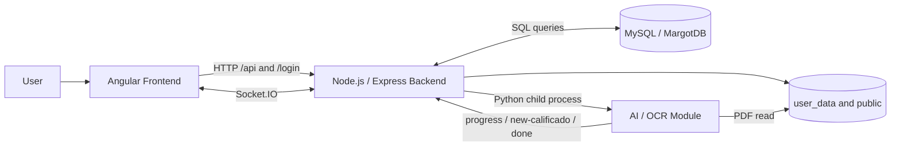

# Madrina

Madrina is a web application for teachers to import, split, identify, grade, and redistribute scanned exam copies.

The application allows you to:

- manage users, subjects, students, and exams
- import a PDF containing multiple exam copies
- convert the PDF to images for manual verification
- automatically detect the start of each copy
- recognise the handwritten DNI/NIF and grade using two CNN models
- associate each copy with a student
- correct or validate the results
- generate a ZIP containing the individual copies and CSV grade files

## Table of Contents

- [Architecture](#architecture)
- [Repository Structure](#repository-structure)
- [Technologies](#technologies)
- [Prerequisites](#prerequisites)
- [Local Installation](#local-installation)
- [Configuration](#configuration)
- [Running the App](#running-the-app)
- [Module Overview](#module-overview)
- [Database](#database)
- [API and WebSocket](#api-and-websocket)
- [Tests and Checks](#tests-and-checks)
- [Production Deployment](#production-deployment)
- [Persistent Data and Backups](#persistent-data-and-backups)
- [Limitations and Warnings](#limitations-and-warnings)
- [Troubleshooting](#troubleshooting)

## Architecture

The project consists of three application modules and a MySQL database.



The AI module is not a standalone HTTP server. The backend spawns `AsistenteWebTFGBackendAIModule/main.py` as a child process when the Socket.IO event `examen-predict` is received.

## Repository Structure

```text
Madrina/
├── AsistenteWebTFG/                   # Angular frontend
│   ├── src/app/                       # Pages and components
│   ├── src/services/                  # API, authentication, storage, socket
│   ├── src/models/                    # TypeScript models
│   └── src/environments/             # Backend URLs for dev/prod
│
├── AsistenteWebTFGBackend/            # Express and Socket.IO backend
│   ├── bin/www                        # Server entry point
│   ├── routes/api.js                  # Authenticated business API
│   ├── routes/login.js                # Registration and authentication
│   ├── routes/socket.js               # PDF import, images, ZIP and AI launch
│   ├── DAL.js                         # Data access layer used by the AI module
│   ├── connection.js                  # MySQL connection
│   ├── user_data/                     # Persistent PDF and working images
│   ├── public/                        # Generated downloadable ZIPs
│   └── mail/                          # Password recovery email template
│
├── AsistenteWebTFGBackendAIModule/    # Python recognition pipeline
│   ├── main.py                        # Entry point called by Node.js
│   ├── core/checkpoints/              # PyTorch models used in production
│   ├── Modules/                       # Result emission, training, testing
│   ├── utils/                         # OCR, PDF processing and CNN models
│   └── data/                          # Dataset preparation and analysis
│
├── MargotDB.sql                       # MySQL schema creation
├── run_full_app.sh                    # Backend + frontend launcher
├── lounch.sh                          # Wrapper for the above script
└── README_projet.md                   # Global documentation
```

The `OriginalVersion/` folder contains historical versions and is not part of the active application.

## Technologies

### Frontend

- Angular 13
- TypeScript 4.5
- Angular Material and Angular CDK
- RxJS
- `ngx-socket-io`
- SCSS

### Backend

- Node.js and Express 4
- Socket.IO 4
- MySQL with `mysql2`
- Archive generation with `archiver`
- PDF processing with Poppler and Ghostscript
- Pug views for error pages

### AI Module

- Python 3
- PyTorch and Torchvision
- OpenCV
- NumPy and Pillow
- PyPDF2
- Levenshtein
- Two CNN models:
  - `best_model.pt` for DNI/NIF character recognition
  - `exammodel4.pt` for handwritten grade digit recognition

### Database

- MySQL
- Schema `MargotDB`
- Main tables: `usuarios`, `preferencias`, `asignaturas`, `alumnos`, `examenes`, `calificados`, and `correo_validacion`

## Prerequisites

The recommended target environment is Debian or Ubuntu.

- Node.js compatible with Angular 13, preferably Node.js 16
- npm
- Python 3 and the `venv` module
- MySQL Server
- Poppler: `pdftoppm`, `pdfseparate`, and `pdfunite`
- Ghostscript: `ps2pdf`
- The `mail` command and a configured MTA if password recovery is needed
- Enough disk space for PDFs, temporary JPEG images, and ZIPs

Install the required system packages on Debian/Ubuntu:

```bash
sudo apt update
sudo apt install mysql-server python3 python3-venv python3-pip \
  poppler-utils ghostscript mailutils
```

Verify the tools are available:

```bash
pdftoppm -v
pdfseparate -v
pdfunite -v
ps2pdf -h
```

A CUDA GPU is optional. The AI module automatically selects CUDA when available, otherwise it runs on CPU.

## Local Installation

All commands are run from the repository root.

### 1. Install the frontend

```bash
cd AsistenteWebTFG
npm ci
cd ..
```

### 2. Install the backend

```bash
cd AsistenteWebTFGBackend
npm ci
cd ..
```

### 3. Install the AI module

By default, the backend looks for `../.venv/bin/python`. This path is configurable via `AI_PYTHON_BIN`. Create the virtual environment at the root:

```bash
python3 -m venv .venv
source .venv/bin/activate
python -m pip install --upgrade pip
python -m pip install \
  torch torchvision numpy Pillow opencv-python PyPDF2 \
  python-Levenshtein matplotlib pandas
deactivate
```

`torchvision`, `matplotlib`, and `pandas` are mainly used by the training, testing, and dataset analysis tools.

Verify the model checkpoints are present:

```bash
test -f AsistenteWebTFGBackendAIModule/core/checkpoints/best_model.pt
test -f AsistenteWebTFGBackendAIModule/core/checkpoints/exammodel4.pt
```

### 4. Initialise MySQL

**Warning:** `MargotDB.sql` drops and recreates all tables in the schema. Do not run it against a production database with data unless you have a backup.

```bash
mysql -u root -p < MargotDB.sql
```

Create a dedicated database user:

```sql
CREATE USER 'madrina'@'localhost' IDENTIFIED BY 'strong_password';
GRANT SELECT, INSERT, UPDATE, DELETE
ON MargotDB.* TO 'madrina'@'localhost';
FLUSH PRIVILEGES;
```

## Configuration

### Backend

Create `AsistenteWebTFGBackend/.env`:

```dotenv
DB_HOST=127.0.0.1
DB_USER=madrina
DB_PORT=3306
DB_PASSWORD=strong_password
DB_NAME=MargotDB
PORT=3000
AI_PYTHON_BIN=../.venv/bin/python
AI_MODULE_PATH=../AsistenteWebTFGBackendAIModule/main.py
AI_MODULE_USER_DATA_ROOT=./user_data
AI_PDF_WORKERS=4
AI_DETECTION_WORKERS=4
```

`connection.js` uses `DB_HOST`, `DB_USER`, `DB_PASSWORD`, `DB_PORT`, `DB_NAME`, and `DB_CONNECTION_LIMIT`. Docker values are defined in `docker-compose.yml`.

The server listens on port `3000` by default. The `PORT` variable overrides this.

### Frontend

Development:

```typescript
// AsistenteWebTFG/src/environments/environment.ts
backend: 'http://localhost:3000'
```

Production:

```typescript
// AsistenteWebTFG/src/environments/environment.prod.ts
backend: 'https://madrina.example.org'
```

The same URL is used for:

- HTTP calls to `/api` and `/login`
- the Socket.IO connection
- downloads served by the backend

`src/proxy.conf.json` contains a legacy remote address and is not referenced by `npm start`. For standard local development, keep the value as `http://localhost:3000`.

### Emails

`AsistenteWebTFGBackend/mail/config.json` contains:

- the domain used in password reset links
- the email subject

The backend calls the system `mail` command directly. Password recovery therefore requires a configured MTA authorised to send messages.

### Working Directories

The backend creates the following directories if they do not exist:

- `AsistenteWebTFGBackend/user_data/` for exam PDFs and images
- `AsistenteWebTFGBackend/public/` for downloadable ZIPs

The AI module creates a temporary workspace at:

```text
AsistenteWebTFGBackendAIModule/utils/.img-dumps/<index>/
```

The system process must have read and write access to these directories.

## Running the App

### Full launch

After installation and configuration:

```bash
chmod +x lounch.sh run_full_app.sh
./lounch.sh
```

The script:

1. starts the backend on `http://localhost:3000`
2. waits two seconds
3. starts Angular on `http://localhost:4200`
4. stops the backend when the frontend is interrupted

The script does not start MySQL and does not install any dependencies.

### Separate launch

Terminal 1:

```bash
cd AsistenteWebTFGBackend
npm start
```

Terminal 2:

```bash
cd AsistenteWebTFG
npm start
```

Then open:

```text
http://localhost:4200
```

### Running the AI module manually

The normal launch path goes through the backend. For manual debugging:

```bash
cd AsistenteWebTFGBackendAIModule

AI_MODULE_USER_DATA_ROOT=/absolute/path/to/AsistenteWebTFGBackend/user_data \
../.venv/bin/python main.py \
  "user-subject-exam" \
  "pdf_filename_without_extension" \
  '[{"dni":"12345678Z","nombre":"Ada","apellidos":"Lovelace"}]'
```

The expected PDF path is:

```text
AsistenteWebTFGBackend/user_data/
└── user-subject-exam/
    └── pdf_filename_without_extension.pdf
```

## Module Overview

### Angular Frontend

Main routes:

| Route | Purpose |
|---|---|
| `/#/login` | Authentication |
| `/#/sign-up` | Account creation |
| `/#/password` | Password reset |
| `/#/asignaturas` | Subject and exam management |
| `/#/examen/:id` | Manual grading |
| `/#/examen-advanced/:id` | AI-assisted automated grading |

The frontend communicates with the backend through:

- `src/services/api/api.service.ts` for the business API
- `src/services/authentication/authentication.service.ts` for accounts
- `src/services/socket/socket.service.ts` for files and progress

### Node.js Backend

The entry point is `AsistenteWebTFGBackend/bin/www`.

On startup, the backend:

1. loads Express
2. verifies the MySQL connection
3. creates the `public` and `user_data` folders if needed
4. mounts the `/api`, `/login`, `/info`, and `/public` routes
5. initialises Socket.IO
6. listens on `PORT` or `3000`

The `/api` routes are protected by an interceptor that verifies the session ID and token against the `usuarios` table.

### AI Pipeline

When a client emits `examen-predict`, the backend:

1. builds the index `<user>-<subject>-<exam>`
2. loads the student list for the subject
3. launches `main.py` with Python
4. passes `AI_MODULE_USER_DATA_ROOT` to the process
5. reads results line by line
6. inserts recognised copies into `calificados`
7. marks the exam as predicted

The Python pipeline:

1. loads the two PyTorch checkpoints
2. converts the relevant PDF areas to images with `pdftoppm`
3. detects the first page of each copy
4. extracts and recognises DNI/NIF characters
5. matches the OCR result to the closest student
6. recognises the handwritten grade
7. emits the result and removes temporary images

Standard output protocol:

```text
progress <percentage> <status>
new-calificado <student_json>
done <duration>
```

Detailed module documentation is available in `AsistenteWebTFGBackendAIModule/README_AI_ASSISTANCE.md`.

## Database

Main relationships:

```text
usuarios
├── preferencias
└── asignaturas
    ├── alumnos
    └── examenes
        └── calificados

usuarios
└── correo_validacion
```

Table descriptions:

| Table | Role |
|---|---|
| `usuarios` | Accounts, hashed password, and session token |
| `preferencias` | CSV encoding, separator, and header row setting |
| `asignaturas` | Subjects belonging to a user |
| `alumnos` | Students enrolled in a subject |
| `examenes` | Exam metadata and processing state |
| `calificados` | Student, pages, grade, and verification state |
| `correo_validacion` | Password recovery tokens |

Backup:

```bash
mysqldump -u madrina -p --single-transaction MargotDB > MargotDB-backup.sql
```

Restore:

```bash
mysql -u madrina -p MargotDB < MargotDB-backup.sql
```

## API and WebSocket

### HTTP API

Routes use `POST` throughout.

Public account routes:

```text
POST /login/insert
POST /login/select
POST /login/delete
POST /login/correo/insert
POST /login/correo/select
POST /login/password/update
```

Main authenticated routes:

```text
POST /api/asignaturas
POST /api/asignaturas/insert
POST /api/asignaturas/update
POST /api/asignaturas/delete
POST /api/asignaturas/select/alumnos

POST /api/examen/insert
POST /api/examen/select
POST /api/examen/delete
POST /api/examen/zip
POST /api/examen/alumnos/select
POST /api/examen/alumnos/select-automatizado

POST /api/calificado/insert
POST /api/calificado/update
POST /api/calificado/update-automatizado

POST /api/preferencias/select
POST /api/prediction/statistics
POST /api/usuario/update/correo
```

### Socket.IO Events

Main events sent by the client:

```text
insert-alumno
insert-examen
select-examen-imgs
select-examen-zip
examen-predict
examen-predict-kill
```

Main events emitted by the server:

```text
insert-examen-procesar
insert-examen-crear
insert-examen-generar
insert-examen-preparar
insert-examen-listo
insert-examen-error
select-examen-imgs
select-examen-zip
examen-predict-response
```

## Tests and Checks

### Frontend

```bash
cd AsistenteWebTFG
npm test
npm run build
```

Angular unit tests use Karma and require a compatible Chrome or Chromium browser.

### Backend

The backend does not currently define a test suite in `package.json`. Minimal check:

```bash
cd AsistenteWebTFGBackend
npm start
```

The server should confirm startup with no MySQL errors.

### AI Module

Verify production imports:

```bash
source .venv/bin/activate
python -c "import torch, cv2, numpy, PIL, PyPDF2, Levenshtein"
deactivate
```

`Modules/train/train.py`, `Modules/test/test.py`, and `example.py` are currently coupled to argument loading from `utils/constants.py`. Their standalone interface must be decoupled before they can be integrated into a standard CI pipeline. The preparation scripts under `data/` remain independent.

### Recommended Validation Walkthrough

1. create an account
2. create a subject
3. import the student list
4. create an exam
5. upload a PDF containing multiple copies
6. verify the page conversion
7. launch the prediction
8. correct the associations and grades
9. generate and download the ZIP
10. check the produced PDFs and CSVs

## Production Deployment

The recommended deployment uses the Dockerfiles and `docker-compose.yml` at the repository root. The full procedure is described in [`README_deploy.md`](README_deploy.md). Quick start:

```bash
docker compose up --build -d
docker compose logs -f
```

The frontend is available on `http://localhost:4200`. Nginx proxies the API, Socket.IO, `/public/`, and `/info/` to the backend. The AI module runs inside the backend container as a Python child process, not as an HTTP service.

The following procedure remains valid for a non-Docker installation with Nginx and systemd.

### 1. Prepare the server

```bash
sudo apt update
sudo apt install nginx mysql-server python3-venv python3-pip \
  poppler-utils ghostscript mailutils
```

Also install:

- Node.js 16 and npm
- a TLS certificate, for example with Certbot
- a working MTA if email sending is required

### 2. Install the application

Example directory:

```text
/opt/madrina/
```

Install dependencies as described in [Local Installation](#local-installation), create `/opt/madrina/.venv`, then configure:

```text
/opt/madrina/AsistenteWebTFGBackend/.env
```

The system account running the backend must have write access to:

```text
/opt/madrina/AsistenteWebTFGBackend/user_data
/opt/madrina/AsistenteWebTFGBackend/public
/opt/madrina/AsistenteWebTFGBackendAIModule/utils/.img-dumps
```

### 3. Build the frontend

First set `environment.prod.ts` to the public domain:

```typescript
backend: 'https://madrina.example.org'
```

Then:

```bash
cd /opt/madrina/AsistenteWebTFG
npm ci
npm run build
```

Static files are generated in:

```text
/opt/madrina/AsistenteWebTFG/dist/frontend/
```

### 4. Create the systemd service

Create `/etc/systemd/system/madrina-backend.service`:

```ini
[Unit]
Description=Madrina Backend
After=network.target mysql.service
Requires=mysql.service

[Service]
Type=simple
User=madrina
Group=madrina
WorkingDirectory=/opt/madrina/AsistenteWebTFGBackend
Environment=NODE_ENV=production
ExecStart=/usr/bin/node ./bin/www
Restart=on-failure
RestartSec=5

[Install]
WantedBy=multi-user.target
```

Adjust the Node.js path obtained with:

```bash
command -v node
```

Enable the service:

```bash
sudo systemctl daemon-reload
sudo systemctl enable --now madrina-backend
sudo systemctl status madrina-backend
```

View logs:

```bash
sudo journalctl -u madrina-backend -f
```

### 5. Configure Nginx

Example `/etc/nginx/sites-available/madrina`:

```nginx
server {
    listen 80;
    server_name madrina.example.org;

    root /opt/madrina/AsistenteWebTFG/dist/frontend;
    index index.html;

    client_max_body_size 500M;

    location / {
        try_files $uri $uri/ /index.html;
    }

    location /api/ {
        proxy_pass http://127.0.0.1:3000;
        proxy_http_version 1.1;
        proxy_set_header Host $host;
        proxy_set_header X-Real-IP $remote_addr;
        proxy_set_header X-Forwarded-For $proxy_add_x_forwarded_for;
        proxy_set_header X-Forwarded-Proto $scheme;
    }

    location /login/ {
        proxy_pass http://127.0.0.1:3000;
        proxy_http_version 1.1;
        proxy_set_header Host $host;
        proxy_set_header X-Forwarded-Proto $scheme;
    }

    location /socket.io/ {
        proxy_pass http://127.0.0.1:3000;
        proxy_http_version 1.1;
        proxy_set_header Upgrade $http_upgrade;
        proxy_set_header Connection "upgrade";
        proxy_set_header Host $host;
        proxy_read_timeout 600s;
        proxy_send_timeout 600s;
    }

    location /public/ {
        proxy_pass http://127.0.0.1:3000;
    }

    location /info/ {
        proxy_pass http://127.0.0.1:3000;
    }
}
```

Enable and test:

```bash
sudo ln -s /etc/nginx/sites-available/madrina /etc/nginx/sites-enabled/madrina
sudo nginx -t
sudo systemctl reload nginx
```

Then add HTTPS and redirect HTTP to HTTPS. The long AI processing times and large PDF sizes justify the high Socket.IO timeouts and the generous upload size limit.

### 6. Post-deployment checks

```bash
curl -I https://madrina.example.org/
sudo systemctl status madrina-backend mysql nginx
sudo journalctl -u madrina-backend --since "10 minutes ago"
```

Then run the full functional walkthrough with a test PDF.

## Persistent Data and Backups

Items to back up:

```text
MySQL database MargotDB
AsistenteWebTFGBackend/user_data/
AsistenteWebTFGBackend/public/
AsistenteWebTFGBackend/.env
AsistenteWebTFGBackendAIModule/core/checkpoints/
```

`user_data/` contains the originals and generated images. `public/` contains ZIP exports. Both folders can grow large — put in place:

- a retention policy
- disk space monitoring
- backups consistent with the database
- controlled cleanup of stale exports

Do not delete an exam folder while its metadata still exists in MySQL.

## Limitations and Warnings

Before any public exposure, address at minimum the following points:

1. Socket.IO and CORS currently accept a very broad origin.
2. The key used to hash accounts is hardcoded in `routes/login.js`.
3. The backend builds certain system commands from application data — inputs and filenames must be strictly validated.
4. PDF and ZIP storage is local to the server with no automatic retention mechanism.
5. Python Docker dependencies are listed in `requirements-docker.txt` but their versions must be kept in sync with the models.
6. There are no automated backend tests or global integration tests.
7. The AI training/testing tools are coupled to the runtime argument loader.
8. Models must remain compatible with the installed version of PyTorch.

Recommended mitigations:

- move remaining secrets into environment variables
- restrict CORS to the frontend domain
- use HTTPS only
- run Node.js and MySQL under unprivileged accounts
- add strict validation of uploaded files
- add database migrations instead of replaying the destructive schema script
- pin and regularly audit `requirements-docker.txt`
- add integration tests covering PDF import and splitting

## Troubleshooting

### Backend exits immediately

Probable cause: cannot connect to MySQL.

```bash
cd AsistenteWebTFGBackend
cat .env
mysql -h 127.0.0.1 -u madrina -p MargotDB
npm start
```

Also verify that the database name is `MargotDB` in the active `connection.js` configuration.

### Frontend cannot reach the backend

Check:

- `src/environments/environment.ts` in development
- `src/environments/environment.prod.ts` after a build
- port `3000`
- the Nginx configuration for `/api`, `/login`, and `/socket.io`

### Socket.IO connection fails behind Nginx

Verify the `Upgrade` and `Connection` headers, then:

```bash
sudo nginx -t
sudo journalctl -u madrina-backend -f
```

### PDF conversion fails

```bash
command -v pdftoppm
command -v pdfseparate
command -v pdfunite
command -v ps2pdf
```

Also check write permissions on `user_data/` and available disk space.

### AI prediction does not start

```bash
test -x .venv/bin/python
.venv/bin/python -c "import torch, cv2, PyPDF2, Levenshtein"
test -f AsistenteWebTFGBackendAIModule/core/checkpoints/best_model.pt
test -f AsistenteWebTFGBackendAIModule/core/checkpoints/exammodel4.pt
```

Also verify `AI_PYTHON_BIN`, `AI_MODULE_PATH`, and `AI_MODULE_USER_DATA_ROOT`. The backend resolves the requested name and accepts the only PDF in the folder when there is exactly one.

### ZIP exports remain stuck

The backend uses `pdfseparate` and `pdfunite` to extract each copy's pages. Verify Poppler is available:

```bash
pdfseparate -v
pdfunite -v
```

### Password recovery emails are not sent

```bash
command -v mail
echo "Test" | mail -s "Madrina test" recipient@example.org
```

